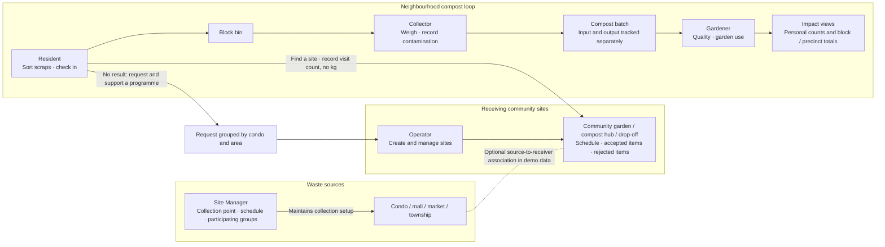

# Soil Loop

**Soil Loop helps neighbourhoods turn separated food scraps into compost and garden use.** It brings residents, waste collection teams, compost and garden teams, receiving community sites, and waste-source organisations into one mobile-first demonstration app.

The project focuses on showing the full community loop with clear ownership and honest impact reporting. A condo or mall is a **waste source**; a community garden, compost hub, or public drop-off point is a **receiving site**. Those are different roles with different records and dashboards.

> **Project status:** Hackathon MVP. The app uses synthetic Precinct 3 demo data and saves changes in the current browser. It is not a production waste-tracking service.


## How the project works

The diagram shows both the composting journey and the two kinds of sites. The source-site manager maintains collection arrangements for a condo, mall, market, or other organisation. The operator maintains community receiving sites and their intake rules. In the seeded Block B walkthrough, a resident checks in, a collector records the collected weight and destination batch, and a gardener records compost quality and garden use.



A site association in the demo is setup information; it does not automatically weigh or attribute a source site's scraps. Residents' community-site visits are recorded separately from block check-ins and kilograms.

## Roles and dashboards

| Role | What they do | Dashboard |
|---|---|---|
| **Resident** | Check the rules for their block, search sample community drop-off sites by area, record a visit, request a programme for their condo, support a request, and see impact. | `/resident` |
| **Site Manager** | Manage a source organisation's collection point, pickup schedule, and participating blocks, tenants, or teams. | `/client-site` |
| **Operator** | Manage receiving community sites, intake schedules and rules; review site requests and precinct-level information. | `/operator` and `/operator/sites` |
| **Collector** | Record a collection's weight, weighing method, contamination status, destination, and batch. | `/collector` |
| **Gardener** | Track batch status and quality, and record compost used in a garden. | `/gardener` |
| **Champion** | Optionally report a block bin's status or an issue. | `/champion` |

The app has separate site concepts: **client sites** (where scraps originate) and **community sites** (where scraps can be received). The current Site Manager login is seeded for a condominium. Another manager account for a mall is present in demo data, even though the login screen shows one Site Manager shortcut.

## Main features

### Resident participation

- View the block's compost guidance and see which partner's rules apply.
- Find clearly labelled sample sites by manually entering an area. Search does not request GPS or claim real-world distances.
- Review a selected site's own schedule, accepted items, rejected items, and drop-off instructions.
- Record repeat visits to a community site. Visits count as visits, never as personal kilograms.
- If no suitable site appears, request a programme for a condo and area. Requests group by normalized name and area; each demo resident can support each request once.
- View personal check-in counts alongside block and precinct impact data.

### Site setup and operations

- Site Managers edit collection details for their source site. They can update the collection point, schedule, and participating groups.
- Operators maintain the receiving-site directory, including site type, area, instructions, schedule, participation settings, accepted and rejected materials, and draft/active visibility.
- Operator site management is distinct from source-site setup: an operator manages where scraps can be received, while a Site Manager manages collection at a condo, mall, or other source.

### Collection-to-garden records

- Collectors record collections with a weight, weighing method, contamination status, and batch/destination.
- Batches keep incoming food-waste weight separate from compost output and garden use.
- Gardeners update batch lifecycle and quality, then record compost application to a garden.
- Dashboard figures are based on the demo's seeded records and the specific metric shown. A rejected load is not counted as accepted diverted weight.

## Data and demo limitations

- **Browser-local persistence:** changes are stored in `localStorage` under `soilloop-demo-v1`. They persist across refreshes in that browser profile, but are not shared with other devices or users.
- **Synthetic content:** sample community sites and seeded people, blocks, collections, batches, and garden records are for demonstration. They are not a verified directory or live service.
- **No production authentication:** the role-picker accounts and password are demo credentials. Do not use real personal or operational data.
- **No live backend:** the application uses seeded TypeScript data and a browser-local store. No database credentials are needed to run the demo.
- **No inferred resident weight:** resident participation is represented by check-in or visit counts. Kilograms come from collection and batch records, not from a resident's visit.
- **Manual site search:** area text search only; no GPS, map, or real-distance calculation.
- **Single seeded programme:** existing Block A/B/C, collection, batch, and garden data remain part of the demo alongside the community-site features.

Use **Reset synthetic demo data** on the login screen to clear local changes and restore the seed data.

## Demo accounts

All seeded demo accounts use the password `demo123`. Choose a role shortcut from the login page or enter an email and password.

| Role | Email |
|---|---|
| Resident (Block B) | `resident@soilloop.demo` |
| Resident (Block A) | `resident.a@soilloop.demo` |
| Collector | `collector@soilloop.demo` |
| Gardener | `gardener@soilloop.demo` |
| Operator | `operator@soilloop.demo` |
| Site Manager (condominium) | `condo.manager@soilloop.demo` |
| Site Manager (mall) | `mall.manager@soilloop.demo` |
| Champion | `champion@soilloop.demo` |

## Project structure

```text
web/
├── public/              # App icons and web manifest
├── src/
│   ├── app/              # Next.js routes and page layouts for each role
│   ├── components/       # Shared UI, navigation, and illustrations
│   └── lib/              # Types, seed data, local store, metrics, site options
├── package.json
└── README.md
```

## Technology

- [Next.js](https://nextjs.org/) App Router and React
- TypeScript
- Tailwind CSS v4
- Browser `localStorage` for demo persistence
- Mermaid for the architecture diagram in this README
